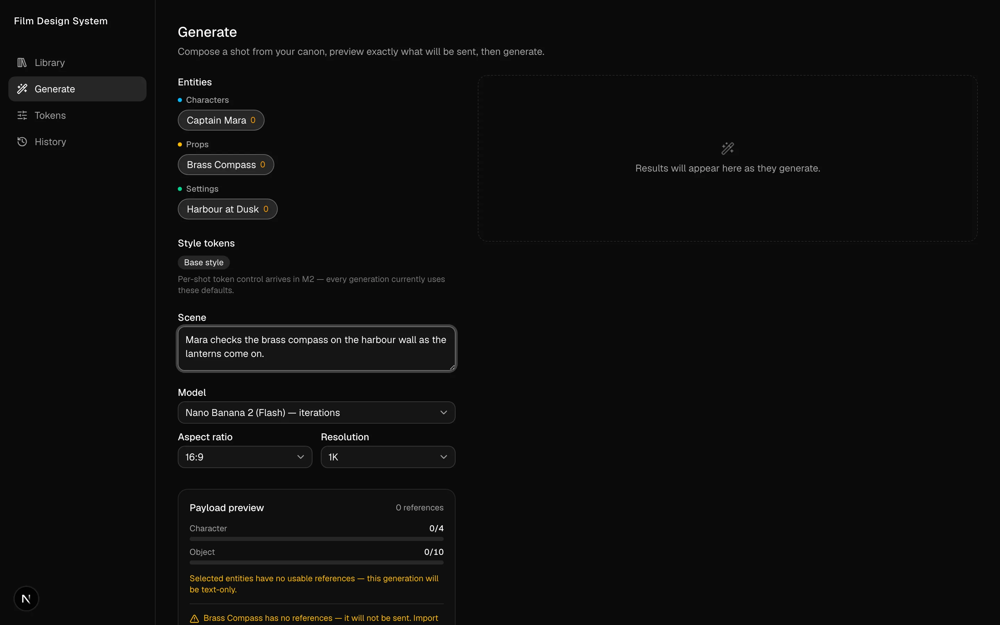

# Film Design System

**Problem.** A film's characters, props and settings have to look the same across hundreds of generated images, and each image model caps how many reference images it accepts.

**Idea.** Manage the film's visual world like a design system. Entities own curated, role-labelled reference images (the canon), a shot picks entities and the app fits their references to the model's caps, and good outputs are promoted back into the reference set.

**Built.** A local-first Next.js app on SQLite (Drizzle) with a library, a generate screen that previews the exact reference payload before a generation is spent, and a history screen that keeps each generation's final prompt and references. Gemini generation is verified live, and GPT Image 2 is registered but unavailable until its adapter is written. 29 commits on 7 days, Aug 2 to Oct 30, 2026.

**Decision.** Gemini and GPT Image 2 get separate reference rules instead of one averaged limit. Gemini's per-category caps are filled, while OpenAI's shared pool of 16 is under-filled to 3 to 5 curated references, because references compete for influence there.

A local-first app that manages a film's visual world the way a design system manages a product UI, and generates imagery against it.

**Entities** — characters, props, settings — each own a curated set of **reference images** (the "canon"), labelled by role and ordered by priority. You compose a shot by picking entities and describing the scene; the app allocates their references within the image model's caps, assembles an exact prompt, calls the provider, and records complete lineage. Good outputs get **promoted** back into the reference set, so a character looks like the same character across hundreds of generations.

The loop: **generate → curate → promote → reference → generate.**



*The Generate screen, captured from a local dev run with three placeholder entities that have no references yet.*

## Quickstart

```bash
npm i
cp .env.local.example .env.local     # then add your GEMINI_API_KEY
mkdir -p library && npm run db:push -- --force && npm run seed
npm run dev
```

`mkdir -p library` matters: `drizzle-kit push` does not create the parent directory and **exits 0 anyway**, so without it the push silently no-ops and every query fails with "no such table" later.

Open http://localhost:3000.

### From the iPad

The dev server binds all interfaces by default, so it's already on the tailnet — no extra flag needed:

```
http://100.75.213.56:3000
```

(That's the Mac Studio's Tailscale address. Both devices need Tailscale up.)

## How the loop works

1. **Library** — create an entity, then import reference images (drag and drop). Each ref gets a **role** (front, three-quarter, full body, expression, detail, environment) and a **priority** (lower = preferred).
2. **Generate** — select entities, write the scene. The **payload preview** shows exactly which references will be sent and how they fill the model's slots, *before* you spend a generation. Warnings appear when a character is squeezed below 3 references, which is where consistency starts degrading.
3. **Promote** — a result you like becomes a reference on an entity, with a role. It's a pointer, not a copy.
4. **History** — every generation keeps its exact final prompt, the references actually sent, the model, and the style-token revision in force. When a character drifts, diff two generations instead of guessing.

## Providers

The two providers have **opposite reference philosophies**, and the app encodes that difference rather than averaging it away.

| | Google Gemini | OpenAI GPT Image 2 |
|---|---|---|
| Caps | Hard per-category — Flash: ≤10 object + ≤4 character; Pro: ≤6 object + ≤5 character | 16, one shared pool |
| Optimal use | **Fill** the slots | **Under-fill** — 3–5 curated refs beat 16; references compete for influence |
| Sizing | aspect ratio + `1K`/`2K`/`4K` token | Explicit pixels (multiples of 16, ≤3840/edge, 655k–8.29M px) |
| Quality | — | `low`/`medium`/`high`/`auto` (35× price range) |

So `selectRefs` is strategy-aware: split mode fills caps, pooled mode allocates a soft recommended budget (5, raisable to 16) and puts characters first.

**Google works and is verified live.** `gpt-image-2` is registered but shows as **unavailable** in the model picker — it needs `OPENAI_API_KEY` plus an adapter in `src/lib/providers/openai.ts` implementing the existing `ImageProvider` interface. That's the only missing piece; the registry, pooled allocation, and pixel-size mapping are already built and tested.

## Where things live

```
library/            images + library.db  (git-ignored — this is your actual film archive)
src/lib/            core: models, select-refs, prompt, output-spec, store, generate, providers/
src/db/             drizzle schema + client
src/app/            screens, server actions, API routes
docs/superpowers/   design spec, multi-provider addendum, implementation plan
```

Images are written to disk **once**. References are DB rows pointing at them — promoting never copies a file, so there's no sync drift.

## Testing

```bash
npm test
```

83 tests, all offline. The live check costs one real generation and is opt-in:

```bash
SMOKE_GEMINI=1 npx vitest run tests/smoke-gemini.test.ts
```

## Known limitations

- **HEIC/HEIF images can't be imported.** sharp here has no HEVC decoder, and iPhone photos are HEIC by default — export as JPEG first. The dropzone rejects them upfront rather than failing deep.
- **Style tokens are M2.** One seeded default token applies to every generation; the Tokens screen is a stub.
- **Safari:** prompt textareas don't auto-grow (`field-sizing` is unsupported there). Cosmetic — they stay usable at their minimum height and scroll.
- **Single user.** Generations run through one in-process serial queue; there's no auth, no multi-writer safety, and no cloud sync. A server restart marks any in-flight generation `failed` with "interrupted — retry".

<!-- BEGIN:generation-family -->
## Related repos

These seventeen repos make Nick's films together, from story to sound. Each handles one stage, and the same table sits in every one of them.

| Stage | Repo | What it does |
|---|---|---|
| Story and worlds | My Films (private) | The film worlds: bibles, scenes, production plans and generated-image archives |
| Story and worlds | Storytelling Kit (private) | Storytelling cards with artwork editions |
| Story and worlds | Film Writer (private) | World-first film development with the screenplay grown from it |
| Craft and reference | film-craft (private) | Craft rules, measured film norms and dated tool tests |
| Craft and reference | Film Analyzer (private) | Frame-by-frame close reading of films |
| Craft and reference | [Look Tokens](https://github.com/weeeha/Look-Tokens) | A film's look as one token table that composes shot prompts |
| Images | [Film Design System](https://github.com/weeeha/Film-Design-System) | Keeps characters, props and settings consistent across image generations |
| Images | [Idea to Prop](https://github.com/weeeha/idea-to-prop) | Keeps one prop design connected from concept image to fabrication |
| 3D, previs and props | 3D Models (private) | Generates 3D models from text, with a viewer and gallery |
| 3D, previs and props | [Scene Builder 3D](https://github.com/weeeha/scene-builder-3d) | Blocks out shots in 3D before anything is generated |
| 3D, previs and props | [film-previz](https://github.com/weeeha/film-previz) | Walk a generated set and save camera shots (spec stage) |
| 3D, previs and props | [Location Lab](https://github.com/weeeha/location-lab) | Scout a real place and hand it to Seedance (design stage) |
| 3D, previs and props | film-props (private) | 3D-printed props and pre-vis sets |
| Video | [Video Generation Pipeline](https://github.com/weeeha/Video-Generation-Pipeline) | Seedance and Runway video generation with reusable reference packs |
| Video | Local Video Pipeline (private) | Wan 2.2 and MiniMax H3 video drafts on a local GPU |
| Video | Continuity Lab (private, in progress) | Finds and repairs inconsistencies between generated video shots |
| Sound | [Audio Generation Pipeline](https://github.com/weeeha/Audio-Generation-Pipeline) | Local speech, voice cloning and sound effects |
<!-- END:generation-family -->
